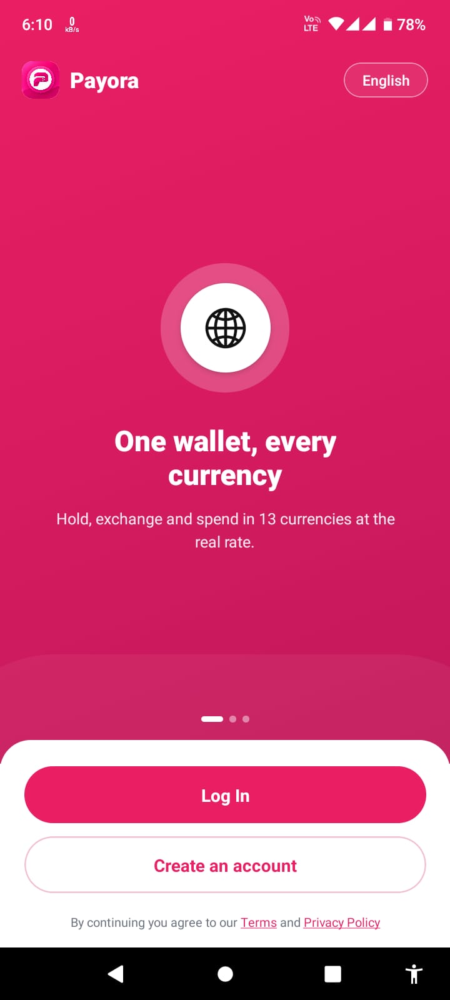
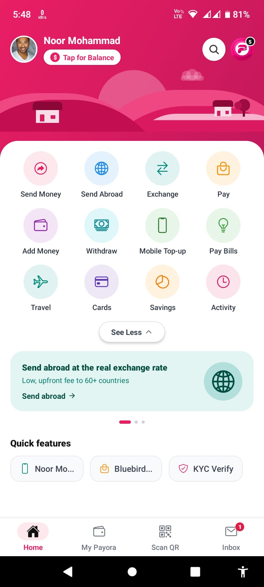
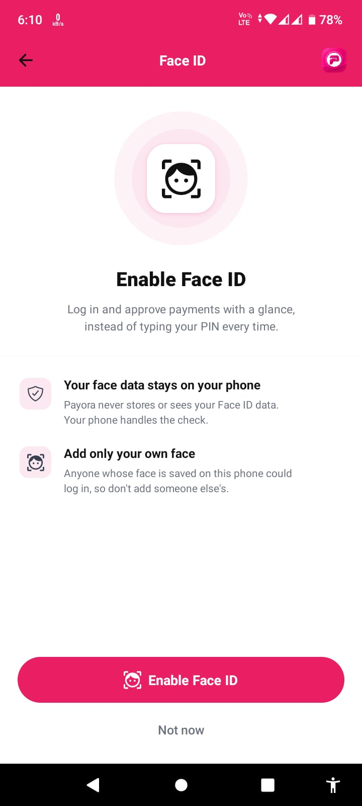
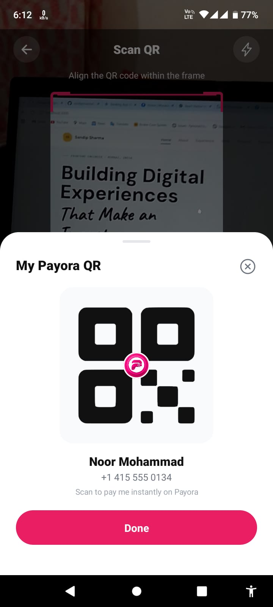
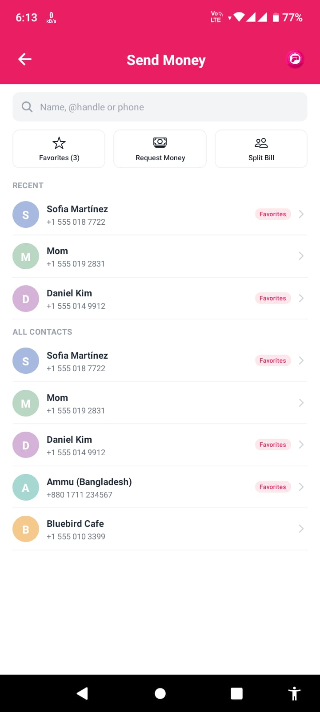
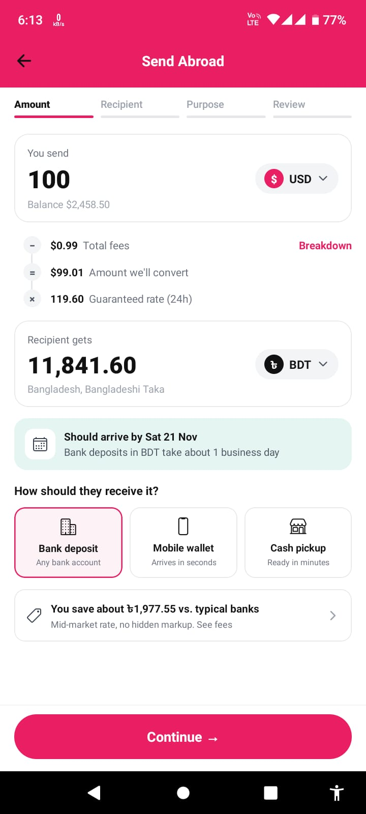
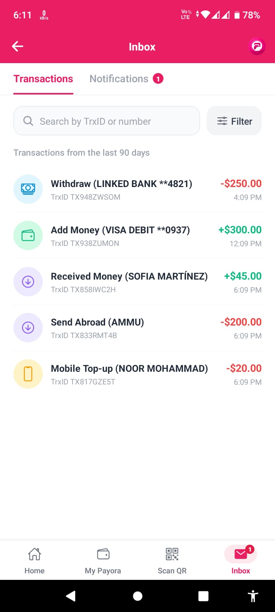
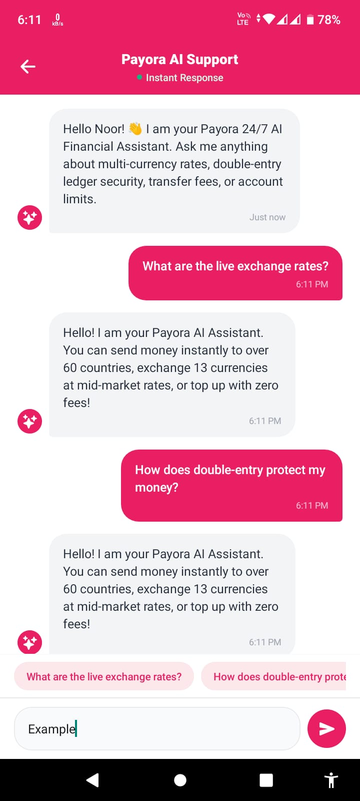

# Payora - Production Fintech Multi-Currency Wallet Application

Payora is a modern fintech multi-currency wallet application featuring a magenta UI design matching the reference specification, backed by a **strict double-entry accounting ledger** built on NestJS and Prisma.

---

## 📱 Tech Stack

- **Frontend**: React Native with Expo (SDK 51), Expo Router (TypeScript)
- **Backend**: NestJS (TypeScript), Prisma ORM
- **Database**: PostgreSQL
- **Authentication**: Firebase Phone Auth + Local JWT Session Management
- **Biometrics**: `expo-local-authentication` (Face ID / Fingerprint)
- **Secure Storage**: `expo-secure-store`
- **Animations**: `react-native-reanimated`, Expo Linear Gradient, React Native Animated API

---

## 🏛 Architecture & The Double-Entry Ledger

In Payora, **account balances are never stored as a mutable number**. Instead, all balances are computed on demand by summing immutable `Entry` records:

$$\text{Account Balance} = \sum_{e \in \text{Entries}} e.\text{amount}$$

### Ledger Invariant

For every financial transaction $T$ (transfer, exchange, deposit, fee):
$$\sum_{e \in T.\text{entries}} e.\text{amount} = 0$$

For example, when Alice sends $100 to Bob with a $1.00 platform fee:

- Alice's Asset Account: **-$100.00** (Debit)
- Bob's Asset Account: **+$99.00** (Credit)
- Payora Platform Fee Revenue Account: **+$1.00** (Credit)
- **Net sum = -100 + 99 + 1 = 0**

---

## 📂 Project Structure

```
banking/
├── backend/                  # NestJS API & Prisma Engine
│   ├── prisma/
│   │   ├── schema.prisma     # Double-entry ledger models: User, Account, Transaction, Entry
│   │   └── seed.ts           # Initial system reserve, Noor Mohammad, multi-currency wallets & txs
│   ├── src/
│   │   ├── auth/             # Firebase JWT verification, signup, login, PIN hashing
│   │   ├── wallet/           # Account aggregation, dynamic balance calculation
│   │   ├── payments/         # Atomic double-entry transfer transactions
│   │   ├── ai-support/       # Streaming LLM support chat with mock fallback
│   │   ├── prisma/           # Prisma client service & lifecycle management
│   │   ├── app.module.ts
│   │   └── main.ts           # Swagger documentation at /api/docs, CORS, Validation
│   └── package.json
└── frontend/                 # Expo React Native App
    ├── app/
    │   ├── _layout.tsx       # Root layout, Auth guard, Web responsive container
    │   ├── (auth)/           # Onboarding Flow (Screenshots 01-05)
    │   │   ├── index.tsx     # 01 Welcome screen
    │   │   ├── phone.tsx     # 02 Mobile number input
    │   │   ├── verify.tsx    # 03 6-digit OTP verification
    │   │   ├── pin.tsx       # 04 5-dot PIN creation
    │   │   └── biometrics.tsx# 05 Face ID setup with privacy notes
    │   ├── (tabs)/           # Main Dashboard Tabs
    │   │   ├── _layout.tsx   # Custom Tab Bar (Home, My Payora, Scan QR, Inbox)
    │   │   ├── index.tsx     # Home Dashboard (Action grid, Tap for Balance, promo banner)
    │   │   ├── my-payora.tsx # My Payora (Rewards, Savings, Favorites, Multi-currency wallets)
    │   │   ├── scan-qr.tsx   # QR Scanner with animated laser & My QR Code modal
    │   │   └── inbox.tsx     # Transactions & notifications feed, receipt modal
    │   ├── send/             # Send Money Flow
    │   │   ├── pick.tsx      # Recipient search & recent contacts
    │   │   ├── amount.tsx    # Large amount input, greeting card selector
    │   │   ├── confirm.tsx   # Summary & 5-digit PIN entry
    │   │   └── press-hold.tsx# Curved magenta hold button with animated progress
    │   ├── send-abroad.tsx   # Send Abroad quote UI (USD -> BDT conversion & fees)
    │   ├── kyc.tsx           # Level 2 KYC verification & document upload
    │   └── ai-support.tsx    # 24/7 AI Assistant chat UI
    └── src/
        ├── context/          # AuthContext with session & biometrics
        ├── services/         # API Client with offline fallback & SecureStorage
        └── theme/            # Magenta theme colors & shadow tokens
```

---

## 📸 App Screens

<table>
  <tr>
    <td align="center"><br><b>Welcome</b></td>
    <td align="center"><br><b>Home Dashboard</b></td>
    <td align="center"><br><b>Face ID Setup</b></td>
  </tr>
  <tr>
    <td align="center"><br><b>Payora QR</b></td>
     <td align="center"><br><b>Send Money</b></td>
    <td align="center"><br><b>Send Abroad</b></td>
  </tr>
  <tr>
    <td align="center"><br><b>Inbox &amp; Transactions</b></td>
    <td align="center"><br><b>AI Support</b></td>
  </tr>
</table>

---

## 🚀 Quick Start Guide

### 1. Backend Setup

```bash
cd backend
npm install
# Generate Prisma Client
npm run prisma:generate
# Seed double-entry ledger database
npm run prisma:seed
# Start backend in development mode
npm run start:dev
```

API Documentation will be available at `http://localhost:3000/api/docs`.

### 2. Frontend Setup

```bash
cd frontend
npm install
# Start on Web (Responsive Desktop & Mobile preview)
npm run web
# Start on iOS / Android
npm run ios
npm run android
```

---

## 🎨 UI/UX Specifications Implemented

1. **Color Palette**: Vibrant Magenta (`#E91E63`), deep magenta accents (`#880E4F`), soft pink badges (`#FCE7EB`), clean white surfaces (`#FFFFFF`), light gray inputs (`#F5F5F7`).
2. **Custom Reusable Numeric Keypad**: Smooth 3x4 grid with tactile feedback and backspace.
3. **Double-Entry Guarantee**: No direct balance mutation; atomic transactions with zero-sum enforcement.
4. **Biometric Face ID**: Integration with `expo-local-authentication` and secure storage enclave.
5. **Press & Hold Interaction**: Fluid animated progress on curved magenta transfer button.
